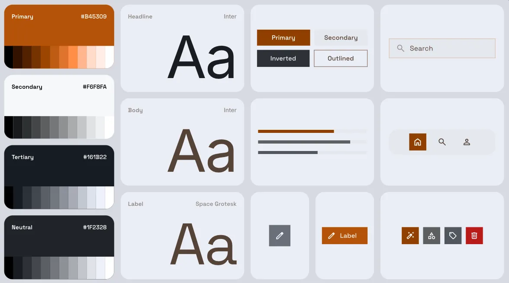
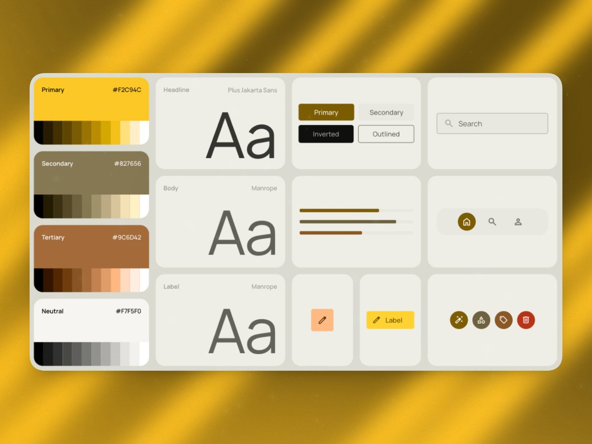
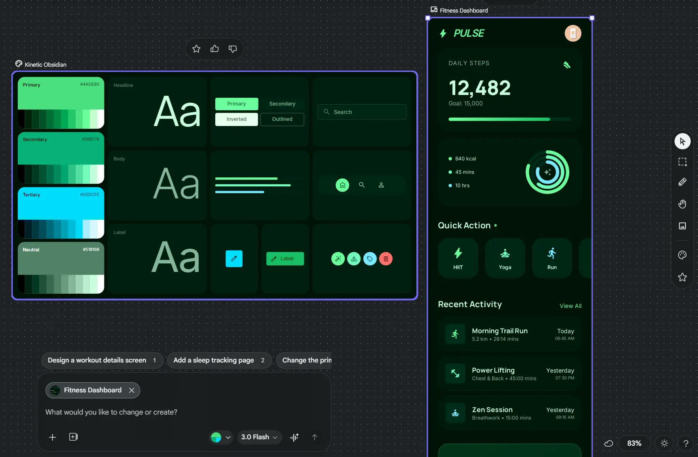

# Competitor check

Notes from looking at Google Stitch and the tools named beside it in design.md §16.2. Screenshots below are copies stored in this folder. Research URLs stay in §16.2. This file does not add a seed group.

Checked 2026-10-29, while shipping product version 1.0.0. See [CHANGELOG.md](../../CHANGELOG.md).

## What we looked at

| Tool | What it produces | What we keep from it |
|---|---|---|
| Google Stitch | A canvas of theme cards and a phone or desktop screen beside each card. A card shows a primary hex, an 11-step ramp, a headline and body family, and a few controls. | The idea of a visible theme card. Our board is that card, generated from §13, with contrast checked. |
| v0 | App UI from a prompt, usually React. | The prompt-to-screen workflow is out of scope here. Components in this repo are the shipped set in `components/`. |
| Aura, designmd.ai, and the other DESIGN.md extractors in §16.2 | A DESIGN.md pulled off a live site, or a builder that emits one. | We write `design-build/exports/DESIGN.md` from our tokens (Google's alpha schema, plus the token file in a fence). Their output is a teardown, not a source of our values. |
| shadcn/ui | A copy-in component set and a theme of CSS variables. | Patterns only, recorded per component in `ui-inventory/components/`. Values stay in §13. |
| Figma variables and Tokens Studio | Modes and token sets inside Figma. | We export `figma.variables.json` and `figma.tokens-studio.json`. The editor stays in Figma. |

## Stitch cards

The orange card names Inter for headline and body, and Space Grotesk for the label. Primary is a single hex (`#B45309`) with a ramp under it. Buttons are Primary, Secondary, Inverted and Outlined.

The yellow card names Plus Jakarta Sans for the headline and Manrope for body and label. Primary is `#F2C94C` on a pale card, over a gold page.

The canvas places a dark theme card (Kinetic Obsidian) beside a phone screen. The card is the pitch. The screen is a separate render.

## What those cards leave open

- The family is a name on the card. This system ships the woff2 and the OFL, and `render.mjs` fails if a system font draws the glyphs. Inter is on the avoid list in core.md §2.
- The hex is the seed, shown as ink. This system turns the seed into `palette.*.50–950`, then aliases roles per theme, and fails the build under 4.5:1 for text and 3:1 for UI.
- One card is one theme. Sodium Yard is dark-first: the default block is dark, and `prefers-color-scheme: light` carries the morning sheet. Godavari Ferry is the other way round. Both are in [seeds.yaml](../../seeds.yaml).
- The phone beside the card is a picture. Our board renders the real components, and `render.mjs` checks 390, 768 and 1280 in every theme.

## shadcn, v0, Aura, DESIGN.md, Figma

shadcn/ui is a pattern source in §16.2 and in [21st-dev.md](21st-dev.md). A pasted shadcn file brings its own colour scale. That scale is not a §13 value.

v0 is listed in §16.2 under AI design workflow, as a draft. It is not a token source.

Aura and the other DESIGN.md extractors in §16.2 are teardown tools. `node design-build/designmd.mjs` writes our DESIGN.md from the default theme. For Sodium Yard that default is dark. For Godavari Ferry it is light. Import reads the `json tokens` fence back unchanged.

Figma variables and Tokens Studio are the files in `design-build/exports/`. One mode per theme in design.md. They are generated. Editing them by hand goes stale (`exports-stale`).
